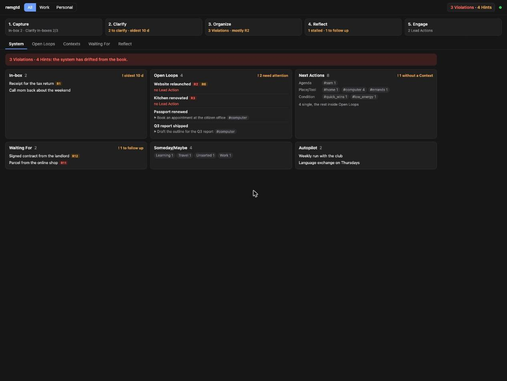

# remgtd

**Getting Things Done, by the book, on top of Apple Reminders.**

remgtd is two things:

1. **A method:** an opinionated set of conventions for running GTD in Apple Reminders.
2. **A read-only View** that opens next to Reminders. It shows your system in GTD terms and tells you where it has drifted from the book.

You keep editing in Reminders, on any device. The View never changes your data, and it updates within about a second of each edit.



*The System tab with demo data: one verdict, one tile per list, and the five-step Step Guide above it.*

## Why

Reminders' smart lists are good for doing, but they can't show structure. A Next Action in a Context list loses the project it belongs to, and nothing tells you that a project has no next step. remgtd gives you:

- **The whole system on one screen**, with a clear verdict: *by the book*, or what has drifted.
- **What Reminders can't show:**
  - an Open Loop (project) with all its actions and its *Lead Action*
  - each Context with the Open Loop behind every action
  - Work or Personal only
- **19 Rules** derived from the original GTD book. Each break is shown as a **Violation** (the Rule is broken) or a **Hint** (probably drifting, may be fine).
- **A Step Guide** for Capture, Clarify, Organize, Reflect and Engage. Each card has the book's key questions and a live status from your data.

## The method in short

| GTD concept | In Reminders |
|---|---|
| In-box | the **In-box** list |
| Project (*Open Loop*) | a top-level reminder in **Open Loops**, titled as the finished outcome |
| Next Action | a subtask of an Open Loop, or an item in **Next Actions**, with at least one Context tag |
| *Lead Action* | the **flagged** Next Action of an Open Loop: the most likely next step |
| Context | a tag that has a smart list inside a Context Kind group (**Agenda**, **Place/Tool**, **Condition**) |
| Waiting For | the **Waiting For** list; each item names a person through an Agenda tag |
| Someday/Maybe | the **Someday/Maybe** list; no Contexts, no flags |
| *Autopilot* (ongoing habit) | the **Autopilot** list; no Contexts, no flags |
| Work / Personal (*Sphere*) | a `#work` tag on Next Actions, and a **Work** section in the other lists |

Further reading:
- [GLOSSARY.md](GLOSSARY.md): the vocabulary
- [docs/rules.md](docs/rules.md): the Rules
- [docs/step-guide.md](docs/step-guide.md): the Step Guide
- [docs/adr/](docs/adr/): the decisions behind the structure, including why it looks like this

## Requirements

- macOS with iCloud Reminders
- [RemCTL](https://github.com/viticci/remctl), installed and onboarded. remgtd reads Reminders only through RemCTL, and only with read commands.
- [uv](https://docs.astral.sh/uv/)
- Optional: [Alfred](https://www.alfredapp.com/) with the Powerpack, for the `gtd` keyword

## Try it without Reminders

```bash
uvx --from git+https://github.com/jonasrk/remgtd remgtd serve --demo
```

Then open <http://127.0.0.1:8765>. You'll see a made-up system that breaks a few Rules on purpose.

## Install

```bash
uv tool install git+https://github.com/jonasrk/remgtd
remgtd doctor        # checks RemCTL, your lists and Contexts
remgtd open          # Reminders left, the View right
```

To update later, run `uv tool upgrade remgtd`.

## Set up Reminders

All of this is done once, by hand, in Reminders. remgtd never creates or changes anything.

1. **Create a list group `GTD`** with six lists: `In-box`, `Open Loops`, `Next Actions`, `Waiting For`, `Someday/Maybe` and `Autopilot`.
2. **Create three list groups for Contexts:** `Agenda`, `Place/Tool` and `Condition`. Inside them, create one smart list per Context, filtering on that one tag. For example, put a smart list `#computer` in Place/Tool, and a smart list `#alex` in Agenda, for a person.
3. **For Work/Personal** (optional), add a section `Work` to Open Loops, Waiting For, Someday/Maybe and Autopilot, and tag Work Next Actions with `#work`. A smart list on `#work` is then your "at work" list. Its flagged items are your Lead Actions.
4. Run `remgtd doctor`.

If your lists have different names, see the configuration section below. Names are matched case-insensitively.

## Use it

| Command | What it does |
|---|---|
| `remgtd open` | Starts the server if needed (in a new iTerm2 or Terminal tab), then shows Reminders on the left and the View on the right, side by side on the main screen. |
| `remgtd check` | Prints Violations and Hints in the terminal (`--json` for scripts). |
| `remgtd serve` | Runs only the server (`--demo` for synthetic data). |
| `remgtd doctor` | Checks the setup. |
| `remgtd init` | Writes a commented config with every default. |

**The View:**
- **System** shows everything at a glance.
- **Open Loops**, **Next Actions** (each action once), **Contexts**, **Waiting For** and **Reflect** show the details.
- The **Work / Personal** switch filters everything.
- The Violation/Hint counter at the top shows only items with problems.
- Clicking an item opens it in Reminders.

**Alfred:** double-click [`integrations/alfred/remgtd.alfredworkflow`](integrations/alfred/remgtd.alfredworkflow) to import it, then type `gtd`.

**Window placement** uses System Events, so the app that runs `remgtd open` (your terminal, or Alfred) needs **Accessibility** permission once. macOS may also ask once whether it may control iTerm, Brave or System Events.

## Configuration

Optional. It lives in `~/.config/remgtd/config.toml` (or `$REMGTD_CONFIG`), never in this repo. Run `remgtd init` to get a commented file with every default:

```toml
group = "GTD"

[lists]
waiting_for = "Waiting for"     # if yours is spelled differently

[sphere]
tag = "work"
section = "Work"

[thresholds]
inbox_days = 7
waiting_days = 14
stalled_days = 30

[view]
weekly_review_url = "https://…" # optional link on the Reflect card

[launcher]
browser = "Brave Browser"       # or "Google Chrome", "Safari"
terminal = "iTerm2"             # or "Terminal"
```

## How it works

- `remgtd serve` reads Reminders through RemCTL: the full export on every tick, plus one sectioned list in rotation.
- It applies the Rules, and pushes the result to the page over Server-Sent Events, but only when something changed.
- When no View is open, it slows down to one read every 30 seconds.
- **Network:** it listens on `127.0.0.1` only and rejects other Host headers.
- **Opening reminders:** the open-in-Reminders endpoint needs a custom header, so other websites can't trigger it.

See [docs/implementation-plan.md](docs/implementation-plan.md) for the design.

## Development

```bash
uv run pytest                              # tests use synthetic data only
uv run remgtd serve --demo                 # work on the View without Reminders
uv run integrations/alfred/build.py        # rebuild the Alfred workflow
```

## License

MIT
